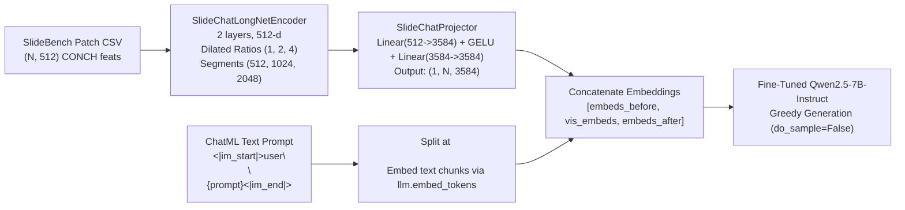
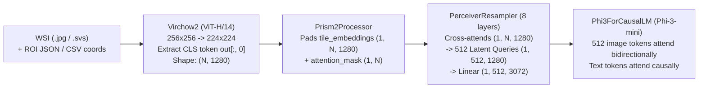
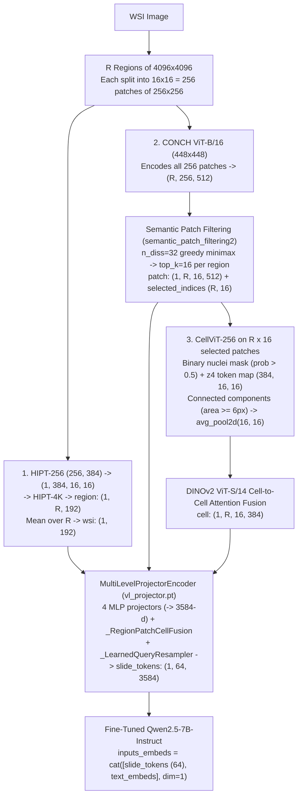

# Model Loading & Inference Pipelines: Technical Report & Upstream Comparison

This document provides a detailed technical reference of how **SlideChat**, **PRISM2**, and **MLLM-HWSI** are loaded and executed during Stage 1 Closed-Ended & `Yes/No` Visual Question Answering (VQA) in **VLMs-eval**.

In particular, for each model we document:
1. **End-to-End Architecture & Tensor Shapes**
2. **Weight Loading Process**
3. **Visual Feature Extraction & Caching Pipeline**
4. **Prompt Construction & Autoregressive Inference**
5. **Exact Comparison: Authors' Official Pipeline vs. `VLMs-eval` Implementation** (highlighting what is 100% identical and any runtime shims or dataset-specific adaptations).

---

## High-Level Summary of Pipeline Fidelity

| Model | Visual Encoders | Slide Aggregator / Projector | LLM Backbone | Weight Fidelity (`strict=True`) | Pipeline Differences vs. Authors' Code |
| :--- | :--- | :--- | :--- | :--- | :--- |
| **SlideChat** | `CONCH` (`512-d` patch features from SlideBench CSV) | `LongNet` (2 layers, `512-d`, dilated ratios `[1,2,4]`, segments `[512,1024,2048]`) + 2-layer MLP (`512 -> 3584`) | `Qwen2.5-7B-Instruct` (fine-tuned in Stage 2) | **100% Exact** (`LongNet_encoder`, `projector`, and `llm` loaded with `strict=True` from `mp_rank_00_model_states.pt`) | **Zero architectural or prompt changes.** Replaced `torchscale` + `flash_attn_func` C++ dependency with an exact pure-PyTorch FP32 scaled dot-product attention + log-sum-exp (`LSE`) implementation inside `DilatedAttention`. |
| **PRISM2** | `Virchow2` (`ViT-H/14`, `1280-d` CLS token per `256x256` tile) | `PerceiverResampler` (8 layers, `512` latent queries of `1280-d`) + `LayerNorm` + `Linear(1280 -> 3072)` | `Phi-3-mini` (`3072-d`, 32 layers) with bidirectional image token mask | **100% Exact** (executes authors' `modeling_prism2.py` & `processing_prism2.py` with all 4 safetensors shards) | **1. Runtime shims for `transformers 5.x` & PyTorch SDPA:** Replaced missing `flash_attn_varlen_func` with `F.scaled_dot_product_attention(..., enable_gqa=True)` and shimmed `Phi3Model._prepare_4d_causal_attention_mask_with_cache_position` using additive float masks so `attn_mask[..., first:last, first:last] = 0` preserves bidirectional image attention.<br>**2. BCNB Coordinate Reconstruction:** Reconstructs exact `(x, y)` `256x256` patch coordinates from `BCNB` `.json` ROI polygons + `.csv` patch names to extract `Virchow2` `1280-d` CLS embeddings. |
| **MLLM-HWSI** | **4-Scale Hierarchy:**<br>• `HIPT-256` (`384-d`) + `HIPT-4K` (`192-d`)<br>• `CONCH` (`512-d`)<br>• `CellViT-256` (`384-d`) + `DINOv2-ViTS14` (`384-d`) | `MultiLevelProjectorEncoder` (4 MLPs `-> 3584-d` + `_RegionPatchCellFusion` + 64-query `_LearnedQueryResampler`) | `Qwen2.5-7B-Instruct` (fine-tuned in `MLLM-HWSI`) | **100% Exact** (`vl_projector.pt`, `LLM` shards, `HIPT`, `CONCH`, `CellViT`, and `DINOv2` all match official checkpoints) | **1. BCNB `4096x4096` Region Cropping:** Authors' `predict.py` reads pyramid `.svs` slides with CLAM `.h5` coordinates via OpenSlide; for `BCNB` `.jpg` biopsies, we crop `4096x4096` windows (with white padding where needed) centered on the `.json` ROI polygons.<br>**2. ChatML Wrapping for VQA:** Authors' open-ended report script (`predict.py`) passes a raw string to `tokenizer(...)`; our VQA adapter wraps the multiple-choice prompt in Qwen2.5's `<|im_start|>` ChatML template. |

---

## 1. SlideChat (`General-Medical-AI/SlideChat`)

**Implementation File:** [`src/models/slidechat.py`](../src/models/slidechat.py)

### 1.1 Architecture Overview


### 1.2 Weight Loading Process ([`SlideChatAdapter.load`](../src/models/slidechat.py#L269-L322))
1. **Base Tokenizer & Architecture Instantiation:**
   - Loads the `AutoTokenizer` and `AutoModelForCausalLM` architecture (`Qwen2ForCausalLM`) in `torch.bfloat16` from `../Models/Qwen2.5-7B-Instruct/`.
   - Instantiates [`SlideChatLongNetEncoder(num_layers=2, embed_dim=512, ffn_dim=1024)`](../src/models/slidechat.py#L209-L228) and [`SlideChatProjector(visual_hidden_size=512, llm_hidden_size=3584)`](../src/models/slidechat.py#L230-L242).
2. **Stage-2 DeepSpeed Checkpoint Application:**
   - Loads `../Models/SlideChat/stage2_pth/mp_rank_00_model_states.pt`, which is a DeepSpeed checkpoint containing a top-level `"module"` state dictionary with three prefixes:
     - `LongNet_encoder.*` (36 parameter tensors)
     - `projector.*` (4 parameter tensors: `model.0.weight/bias`, `model.2.weight/bias`)
     - `llm.*` (339 parameter tensors: full fine-tuned Qwen2.5-7B weights)
   - Strips each prefix and calls `.load_state_dict(..., strict=True)` on `self.longnet_encoder`, `self.projector`, and `self.llm`.

### 1.3 Inference Pipeline ([`SlideChatAdapter.predict_vqa`](../src/models/slidechat.py#L356-L404))
1. **Feature Loading:**
   - Reads `<slide_id>.csv` from `../Datasets/SlideBench/BCNB/Feat/BCNB_patch_feat/` via [`load_patch_features_csv`](../src/datasets/slidebench_vqa.py), yielding a tensor of shape `(1, N, 512)` (capped at `max_patches=38400`).
2. **LongNet Slide Encoding & Projection:**
   - Permutes `(1, N, 512) -> (N, 1, 512)` to match SlideChat's convention (`patch_feats.permute(1, 0, 2)`), passes through `longnet_encoder`, permutes back to `(1, N, 512)`, and projects to `(1, N, 3584)` via `projector`.
3. **Multimodal Input Embedding Splice ([`_prepare_multimodal_inputs`](../src/models/slidechat.py#L324-L354)):**
   - Formats the prompt using XTuner's Qwen2.5 ChatML template:
     ```text
     <|im_start|>user
     <image>
     {question_and_options}<|im_end|>
     <|im_start|>assistant
     ```
   - Splits the string at `<image>`, tokenizes both text halves (`chunk0_ids` with special tokens, `chunk1_ids` with `add_special_tokens=False`), embeds them with `self.llm.get_input_embeddings()`, and concatenates `[embeds_0, vis_embeds, embeds_1]` along sequence dimension `0`.
   - Builds contiguous `position_ids = [0, 1, ..., seq_len - 1]` and `attention_mask = ones(1, seq_len)`.
4. **Autoregressive Decoding:**
   - Calls `self.llm.generate(..., do_sample=False, max_new_tokens=128)` stopping at either `eos_token_id` or `<|im_end|>`.

### 1.4 Comparison with Authors' Official Pipeline
- **100% Identical:**
  - Feature inputs (`SlideBench` `CONCH` `512-d` CSVs are the exact features released by the SlideChat/SlideBench authors).
  - Model weights (`strict=True` across all 3 submodules).
  - Prompt template, `<image>` token splicing, `permute(1, 0, 2)` tensor orientation, and greedy decoding parameters.
- **What Changed (Runtime Dependency Only):**
  - The official SlideChat repository requires `xtuner`, `mmengine`, `torchscale`, and `flash-attn`. Inside `torchscale`'s `DilatedAttention`, `flash_attn_func(qi, ki, vi, return_attn_probs=True)` is used to obtain the attention output `out` and softmax log-sum-exp `lse` for each `(segment_length, dilated_ratio)` pair `[(512, 1), (1024, 2), (2048, 4)]`.
  - In [`SlideChatDilatedAttention._attention_with_lse`](../src/models/slidechat.py#L104-L117), we compute exact FP32 scaled dot-product attention and `torch.logsumexp(scores, dim=-1)` directly in PyTorch without requiring `torchscale` or `flash-attn`. Because FlashAttention is an IO-aware exact algorithm for standard scaled dot-product attention + LSE, our pure-PyTorch implementation is **mathematically identical** to the authors' code.

---

## 2. PRISM2 (`Paige-AI/Prism2`)

**Implementation Files:** [`src/models/prism2.py`](../src/models/prism2.py) and [`src/datasets/feature_extractor.py`](../src/datasets/feature_extractor.py#L152-L210)

### 2.1 Architecture Overview


### 2.2 Weight Loading Process ([`PRISM2Adapter.load`](../src/models/prism2.py#L147-L175))
1. **Dynamic Loading of Official PRISM2 Python Modules:**
   - Loads the authors' original files directly from `../Models/PRISM2/`:
     - `configuration_prism2.py` (`Prism2Config`)
     - `processing_prism2.py` (`Prism2Processor`)
     - `modeling_prism2.py` (`Prism2Model`)
     - `perceiver_resampler.py` (`PerceiverResampler`)
2. **Sharded Safetensors Loading:**
   - Instantiates `Prism2Model(config)` in `torch.bfloat16` on the target GPU and loads all 4 checkpoint shards (`model-00001-of-00004.safetensors` through `model-00004-of-00004.safetensors`) via `safetensors.torch.load_file` and `model.load_state_dict(shard_sd, strict=False, assign=True)`.

### 2.3 Visual Feature Extraction ([`Virchow2FeatureExtractor`](../src/datasets/feature_extractor.py#L152-L210))
1. **Foundation Encoder (`Paige-AI/Virchow2`):**
   - Instantiates `timm` `vit_huge_patch14_224` with `mlp_layer=SwiGLUPacked`, `act_layer=torch.nn.SiLU`, `reg_tokens=4`, and loads `../Models/Encoders/Virchow2/model.safetensors` with `strict=True`.
   - Applies Virchow2's official `timm` preprocessing transform (`Resize(224, BICUBIC) -> CenterCrop(224) -> Normalize(mean=[0.485, 0.456, 0.406], std=[0.229, 0.224, 0.225])`).
2. **CLS Token Selection (`1280-d`):**
   - For each `256x256` tile crop, `Virchow2` outputs a tensor of shape `(B, 261, 1280)` (`index 0` = CLS token, `indices 1..4` = register tokens, `indices 5..260` = `16x16` patch tokens).
   - Following `Prism2Config.tile_embedding_dim = 1280` and Paige's PRISM/PRISM2 specification, we extract **only the CLS token `out[:, 0]`** (`(B, 1280)`) and cache the resulting `(N, 1280)` tensor in `../Datasets/SlideBench/<cohort>/Feat/PRISM2_Virchow2/<slide_id>.pt`.

### 2.4 Prompt Construction & Inference ([`PRISM2Adapter.predict_vqa`](../src/models/prism2.py#L221-L266))
1. **Prompt Construction:**
   - Formats the question and options as:
     ```text
     {question}
     Options:
     A. {opt_A}
     B. {opt_B}
     ...
     Answer with the single best option letter (e.g., A, B, C, or D).
     ```
2. **Execution via `Prism2Model.get_response`:**
   - Calls `self.processor([tiles])` to produce `tile_embeddings` `(1, N, 1280)` and `attention_mask` `(1, N)`.
   - Calls the authors' `self.model.get_response(tile_embeddings=..., attention_mask=..., prompt=prompt, max_new_tokens=32, do_sample=False)`.
   - Internally, `modeling_prism2.py` wraps the prompt in Phi-3's chat template with 512 `<|image|>` placeholder tokens:
     ```text
     <|user|>
     <|image|>... (x512) ...<|image|>{prompt}<|end|>
     <|assistant|>
     ```
   - Replaces the 512 `<|image|>` positions with the output of `PerceiverResampler` + `img_projection` (`(1, 512, 3072)`), modifies the 4D causal attention mask so the 512 image tokens attend bidirectionally to each other (`attn_mask[i, :, first:last, first:last] = 0`), and runs greedy generation.

### 2.5 Comparison with Authors' Official Pipeline
- **100% Identical:**
  - Uses the authors' untouched `modeling_prism2.py`, `processing_prism2.py`, `perceiver_resampler.py`, and `configuration_prism2.py`.
  - Uses `Paige-AI/Virchow2` `1280-d` CLS tokens (`out[:, 0]`).
- **What Changed (Compatibility Shims & BCNB Tile Discovery):**
  1. **PyTorch SDPA Shim for `flash_attn_varlen_func` ([`_sdpa_flash_attn_varlen_func`](../src/models/prism2.py#L24-L50)):**
     - `perceiver_resampler.py` imports `from flash_attn import flash_attn_varlen_func`. Because `flash-attn` is not compiled in the environment, we provide a drop-in replacement using `torch.nn.functional.scaled_dot_product_attention(..., is_causal=causal, enable_gqa=enable_gqa)` sliced by `cu_seqlens_q` and `cu_seqlens_k`. Since `PerceiverResampler` uses standard multi-head/GQA dot-product attention with `causal=False`, this is **mathematically identical**.
  2. **`transformers 5.x` 4D Causal Attention Mask Shim ([`_install_prism2_runtime_shims`](../src/models/prism2.py#L63-L102)):**
     - `modeling_prism2.py` was written for `transformers ~4.41` and calls `Phi3Model._prepare_4d_causal_attention_mask_with_cache_position(...)`, which returned an **additive float mask** (`0.0` for allowed positions, `finfo(dtype).min` for masked positions). `modeling_prism2.py` then executes `attn_mask[i, :, first:last, first:last] = 0` to unmask the upper triangle of the `512x512` image-token block (enabling bidirectional image attention).
     - In `transformers 5.22+`, `_prepare_4d_causal_attention_mask_with_cache_position` was removed in favor of `create_causal_mask` (which returns a boolean tensor where `True` = attend and `False` = mask). If a boolean mask were passed into `modeling_prism2.py`, setting `= 0` (`False`) would **mask out** the image tokens instead of unmasking them! Our shim calls `create_causal_mask` and converts it to the exact additive float mask (`0.0` vs. `finfo(dtype).min`) expected by `modeling_prism2.py`.
  3. **BCNB Tile Coordinate Discovery ([`discover_tissue_patch_coords_256`](../src/datasets/feature_extractor.py#L35-L70)):**
     - `SlideBench` does not distribute pre-extracted `Virchow2` features for `BCNB`. Instead, we reconstruct the exact `(x, y)` coordinates of the `N` patches used by `SlideBench` by parsing `<slide_id>.json` (`positive` ROI polygon bounding boxes `(min_x, min_y)`) and `<slide_id>.csv` (`<slide_id>_<ann_id>_<off_x>_<off_y>.jpg` -> `(min_x + off_x, min_y + off_y)`). Thus, `PRISM2` evaluates the **exact same `N` tissue patches per slide** as `SlideChat`.

---

## 3. MLLM-HWSI (`DreamMr/MLLM-HWSI`)

**Implementation Files:** [`src/models/mllm_hwsi.py`](../src/models/mllm_hwsi.py) and [`src/datasets/feature_extractor.py`](../src/datasets/feature_extractor.py#L217-L753)

### 3.1 Architecture Overview


### 3.2 Weight Loading Process ([`MLLMHWSIAdapter.load`](../src/models/mllm_hwsi.py#L262-L294))
1. **Projector Configuration & Weights:**
   - Reads `../Models/MLLM-HWSI/projector_config.json` (`llm_dim=3584, hidden_dim=1024, dropout=0.1, use_layernorm=True, num_query_tokens=64, projector_type="mlp"`).
   - Instantiates [`MultiLevelProjectorEncoder`](../src/models/mllm_hwsi.py#L204-L238) and loads `../Models/MLLM-HWSI/vl_projector.pt` (`vl_projector_state_dict`) with `strict=True` in `torch.float32`.
2. **Fine-Tuned Qwen2.5-7B-Instruct Backbone:**
   - Loads `AutoModelForCausalLM.from_pretrained("../Models/MLLM-HWSI", torch_dtype=torch.float16)` from the 4 safetensors shards in `../Models/MLLM-HWSI/`.
   - Loads `AutoTokenizer` from `../Models/Qwen2.5-7B-Instruct/` (since the upstream `DreamMr/MLLM-HWSI` Hugging Face repo omitted `tokenizer.json` and `vocab.json`).

### 3.3 Four-Scale Feature Extraction Pipeline ([`MLLMHWSIFeatureExtractor`](../src/datasets/feature_extractor.py#L612-L753))
Every step below directly mirrors the functions in the authors' official `predict.py`:
1. **Scale 1 & 2 — `wsi` `(1, 192)` and `region` `(1, R, 192)` via HIPT:**
   - Each `4096x4096` region is divided into a `16x16` grid of `256` patches (`256x256` each) normalized with `mean=(0.5, 0.5, 0.5), std=(0.5, 0.5, 0.5)`.
   - `HIPTViT256` (`vit_256_small_dino.pth`, `"teacher"` key) extracts `(256, 384)`, which is reshaped to `(1, 16, 16, 384) -> permute(0, 3, 1, 2) -> (1, 384, 16, 16)`.
   - `HIPTViT4K` (`vit_4096_xs_dino.pth`, `"teacher"` key) aggregates the `16x16` grid into a `(1, 192)` region vector.
   - Stacking across all `R` regions yields `region` `(1, R, 192)`, and averaging across `R` yields `wsi` `(1, 192)`.
2. **Scale 3 — `patch` `(1, R, 16, 512)` via CONCH + Semantic Patch Filtering:**
   - All `256` patches in each region are resized/cropped to `448x448` and encoded via `ConchVisualEncoder.encode_image(..., normalize=False)` (`../Models/Encoders/CONCH/pytorch_model.bin`), producing `(R, 256, 512)`.
   - [`_semantic_patch_filtering_inference`](../src/datasets/feature_extractor.py#L572-L609) runs the exact `semantic_patch_filtering2` algorithm from `predict.py`:
     - L2-normalizes the 256 patch features and computes the `256x256` cosine similarity matrix.
     - Picks the patch with the lowest mean similarity to all other patches as `seed_idx`.
     - Iteratively selects `n_diss_features = 32` maximally dissimilar patches using greedy minimax cosine similarity.
     - Uses `query_feat = diss_feat[0:1]` (the official inference fallback when no ground-truth report embedding is provided) to select the `top_k = 16` patches (`(R, 16, 512)`) and their indices `selected_indices` (`(R, 16)`).
3. **Scale 4 — `cell` `(1, R, 16, 384)` via CellViT-256 + DINOv2 ViT-S/14:**
   - Only the `R x 16` selected patches are passed through `CellViT256Standalone` (`../Models/Encoders/CellViT/CellViT-256-x40-AMP.pth`, loaded with `strict=True`).
   - `CellViT-256` outputs `nuclei_binary_map` probabilities `(B, 2, 256, 256)` and final encoder token map `z4` `(B, 384, 16, 16)`.
   - Connected components (`scipy.ndimage.label`) on `(bin_probs[:, 1] > 0.5)` identifies individual nuclei instances; instances with `< 6` pixels are discarded.
   - Each nucleus binary mask is downsampled to `16x16` via `F.avg_pool2d(mask, kernel_size=16, stride=16) > 0` to pool the corresponding `384-d` tokens from `z4`.
   - All nuclei feature vectors inside a patch are stacked `(M, 384)` and passed through `CellToCellAttentionFusionViTS` (`timm` `vit_small_patch14_dinov2.lvd142m` transformer blocks + LayerNorm, returning the `384-d` CLS token `x[0, 0]`). If a patch has zero detected nuclei, a zero vector `zeros(384)` is used.

### 3.4 Multi-Level Projection & LLM Inference ([`MLLMHWSIAdapter.predict_vqa`](../src/models/mllm_hwsi.py#L368-L408))
1. **MultiLevelProjectorEncoder:**
   - Projects `wsi`, `region`, `patch`, and `cell` to `3584-d`, fuses them via `_RegionPatchCellFusion`, and compresses them into `64` visual query tokens (`slide_tokens` of shape `(1, 64, 3584)`).
2. **Prefix Concatenation:**
   - Prepends `slide_tokens` directly in front of the tokenized text embeddings:
     ```python
     inputs_embeds = torch.cat([slide_tokens, text_embeds], dim=1)
     attention_mask = torch.cat([prefix_attention_mask, text_attention_mask], dim=1)
     ```
   - Calls `self.llm.generate(inputs_embeds=inputs_embeds, attention_mask=attention_mask, max_new_tokens=32, do_sample=False, num_beams=1)`.

### 3.5 Comparison with Authors' Official Pipeline (`predict.py`)
- **100% Identical:**
  - `MultiLevelProjectorEncoder` architecture and `vl_projector.pt` weights (`strict=True`).
  - `semantic_patch_filtering2` (`n_diss_features=32, top_k=16`, self-query `diss_feat[0:1]`).
  - `CellViT-256` nuclei instance segmentation threshold (`prob > 0.5`, `area >= 6`), `16x16` average-pooling token alignment, and `vit_small_patch14_dinov2.lvd142m` cell-to-cell attention fusion.
  - Prefix concatenation `torch.cat([slide_tokens, text_embeds], dim=1)` and greedy decoding (`do_sample=False, num_beams=1`).
- **What Changed (Important Details to Review):**
  1. **Standalone `ConchVisualEncoder` and `CellViT256Standalone` Wrappers:**
     - Instead of requiring external clones of `MahmoodLab/CONCH` and `TIO-IKIM/CellViT`, we implemented their exact PyTorch `nn.Module` architectures in [`src/datasets/feature_extractor.py`](../src/datasets/feature_extractor.py#L366-L547) and verified `strict=True` state-dict loading against `CONCH/pytorch_model.bin` and `CellViT-256-x40-AMP.pth`.
  2. **`4096x4096` Region Discovery on BCNB JPGs ([`discover_region_coords_4096`](../src/datasets/feature_extractor.py#L102-L130)):**
     - The authors' `predict.py` uses `openslide.OpenSlide(wsi_path)` + CLAM `.h5` coordinates to read `4096x4096` regions from pyramidal `.svs` WSIs. Because `BCNB` slides are single-scale `.jpg` images accompanied by `<slide_id>.json` ROI annotations (and many biopsy strips are narrower than `4096` pixels in width or height), our extractor centers `4096x4096` crops on the annotated ROI polygons (padding out-of-bounds areas with white `(255, 255, 255)` background). For `.svs` cohorts (`CPTAC`), standard `4096x4096` region tiling applies.
  3. **ChatML Prompt Formatting vs. Raw String Tokenization ([`MLLMHWSIAdapter._format_chat`](../src/models/mllm_hwsi.py#L351-L366)):**
     - In the authors' `predict.py` (which is a demo script for **Stage 2 open-ended report generation**), the prompt `"Please generate a diagnostic report for this whole-slide image:"` is passed directly to `tokenizer(prompt, ...)` **without** Qwen2.5's `<|im_start|>system...<|im_start|>user...<|im_start|>assistant` ChatML wrapper.
     - In [`MLLMHWSIAdapter`](../src/models/mllm_hwsi.py#L351-L366), we used `tokenizer.apply_chat_template(...)` for Stage 1 VQA.
     - **Note for Experimentation:** During our 20-sample BCNB pilot, `MLLM-HWSI` achieved **85.71% on binary questions** and **75.00% on Yes/No questions**, but only **11.11% on 4-option multiple-choice questions** (frequently defaulting to option `A`). If `MLLM-HWSI` was fine-tuned without ChatML special tokens (i.e., raw text continuation right after the 64 visual prefix tokens), removing `_format_chat` or using a continuation-style prompt (`"Question: ...\nOptions:\n...\nAnswer:"`) may significantly improve its 4-option multiple-choice accuracy.
